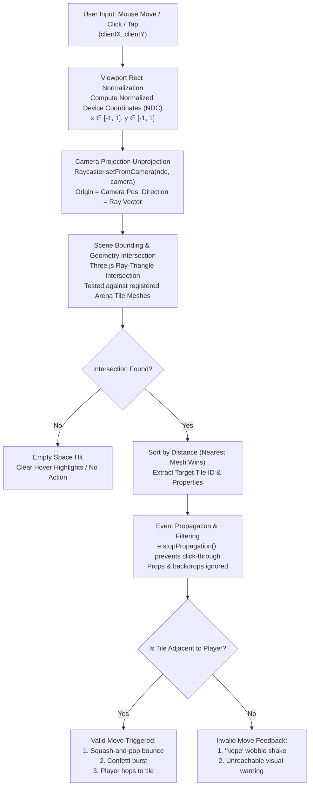

# 3D Raycasting & Tile Interaction Architecture

This document details the raycasting and pointer-interaction pipeline implemented in **FloorIsALiar**, from raw screen-space pointer events down to 3D world ray intersections and click-to-move state execution.

---

## 1. Raycasting Pipeline Overview

---

## 2. Mathematical Steps: Screen Space to 3D World Intersection

### Step 1: Screen-Space Coordinates to Normalized Device Coordinates (NDC)
When a user moves or clicks their mouse/touchscreen, the browser emits viewport coordinates $(x_{\text{pixel}}, y_{\text{pixel}})$ relative to the canvas bounding rectangle:

$$\begin{aligned}
x_{\text{NDC}} &= \left( \frac{x_{\text{pixel}} - \text{rect.left}}{\text{rect.width}} \right) \times 2 - 1 \\
y_{\text{NDC}} &= -\left( \frac{y_{\text{pixel}} - \text{rect.top}}{\text{rect.height}} \right) \times 2 + 1
\end{aligned}$$

- At the center of the viewport, $(x_{\text{NDC}}, y_{\text{NDC}}) = (0, 0)$.
- Top-left corner is $(-1, 1)$, and bottom-right corner is $(1, -1)$.

### Step 2: Camera Unprojection & Ray Generation
In Three.js, `THREE.Raycaster.setFromCamera(pointerNDC, camera)` unprojects the 2D NDC point into 3D world space using the camera's inverse projection matrix and inverse view matrix:

$$\vec{r}_{\text{origin}} = \vec{C}_{\text{camera}}$$
$$\vec{r}_{\text{direction}} = \text{normalize}\left( \mathbf{M}_{\text{view}}^{-1} \mathbf{M}_{\text{proj}}^{-1} \begin{bmatrix} x_{\text{NDC}} \\ y_{\text{NDC}} \\ 1 \\ 1 \end{bmatrix} \right)$$

This yields a parametric 3D ray in world coordinates:

$$\vec{P}(t) = \vec{r}_{\text{origin}} + t \cdot \vec{r}_{\text{direction}} \quad (t \ge 0)$$

### Step 3: Geometry Intersection & Distance Sorting
The ray is cast against candidate meshes. Three.js performs two stages of testing:
1. **Ray-Sphere / Ray-Box Bounding Volume Check:** Quick rejection of tiles outside the ray path.
2. **Ray-Triangle Intersection (Möller–Trumbore algorithm):** Computes the exact barycentric coordinates $(u, v)$ and intersection distance $t$.

All hits are returned sorted by ascending distance ($t_0 \le t_1 \le t_2$). The closest hit ($t_0$) represents the surface directly under the cursor.

---

## 3. Propagation & Environmental Filtering

### A. Preventing Decorative Mesh Occlusion
In a 3D scene with props (giant speaker stacks, hanging mirror balls, background dome, floor abyss plane), rays fired toward a tile must never accidentally hit or be stolen by decorative props:
- **Solution:** Decorative meshes either have `raycast={() => null}` or are excluded from event handlers.
- Only actual `<TileMesh>` components register interactive pointer events (`onPointerOver`, `onPointerOut`, `onPointerDown`, `onClick`).

### B. Event Propagation & StopPropagation
Each tile's event handler invokes `e.stopPropagation()` immediately upon intersection. This guarantees that only the single topmost tile receives the interaction event and prevents double registration from stacked geometries or overlapping hitboxes.

### C. HUD Non-Interference
The React HTML overlays (timer, score HUD, loudspeaker banner, start/game-over screens) are styled with:
- `pointer-events-none` on overlay backdrop containers so mouse clicks fall straight through to the 3D Canvas.
- `pointer-events-auto` on clickable interactive UI buttons (e.g. "Overview", "Play", "Rules"). Clicking a HUD button stops event propagation so no underlying 3D tile is triggered.

---

## 4. Click-to-Move & Adjacency Validation

1. **Reachable Check:**
   When hovering or clicking a tile with `targetId`, the system queries the pure graph function `isAdjacent(currentTileId, targetId)`:
   - **Reachable (Adjacent):** 
     - Hover: Tile lifts ($Y + 0.14$), top edge highlights with a bright border, cursor switches to `pointer`.
     - Click: Triggers a **squash-and-pop** spring animation, emits click confetti particles, and moves the dancer along a smooth parabolic hop.
   - **Unreachable (Non-Adjacent):**
     - Hover: Muted tint, cursor displays `not-allowed`.
     - Click: Triggers a rapid horizontal **"nope" shake** on the tile and brief "Too far!" toast/indicator without moving the player.
2. **Movement Lock:**
   While the player's hop animation is active (`isHopping = true`), all tile click events are ignored until the hop completes and the player is safely planted on the new tile.

---

## 5. Touch & Mobile Support

On touch devices (smartphones and tablets):
- Touch does not trigger hover states (`hover` is simulated or skipped).
- A single tap triggers `onPointerDown`/`onClick`.
- The system prevents duplicate events caused by synthetic mouse emulation (`click` following `touchend`) by tracking timestamps and unique pointer IDs.
